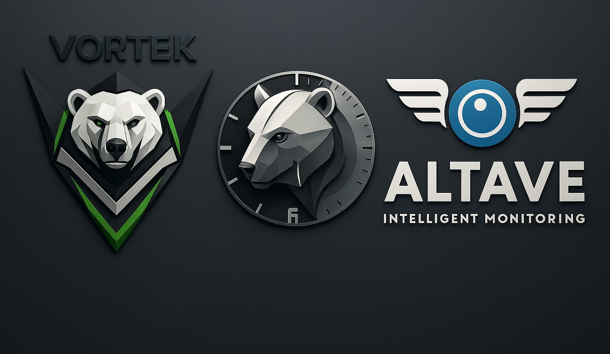
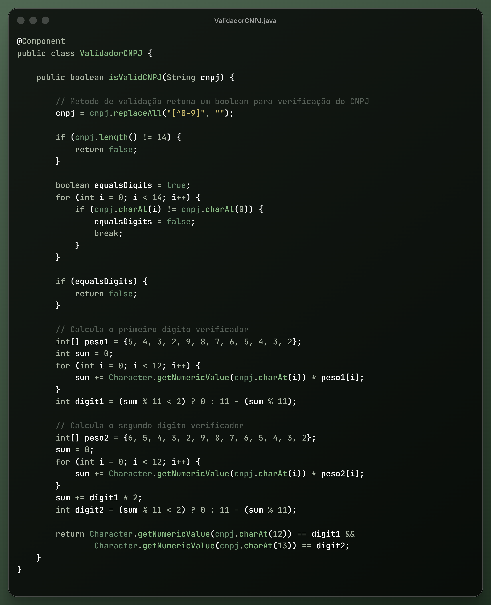
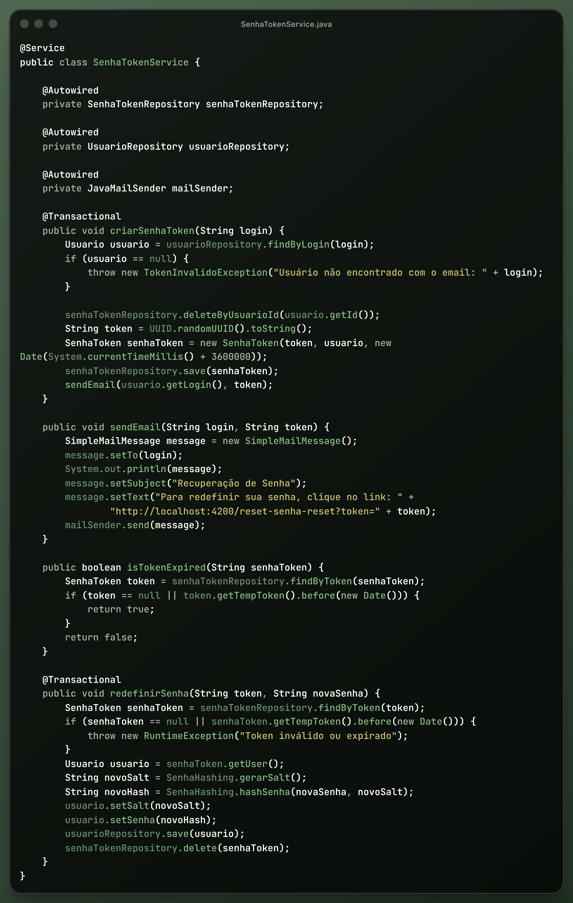
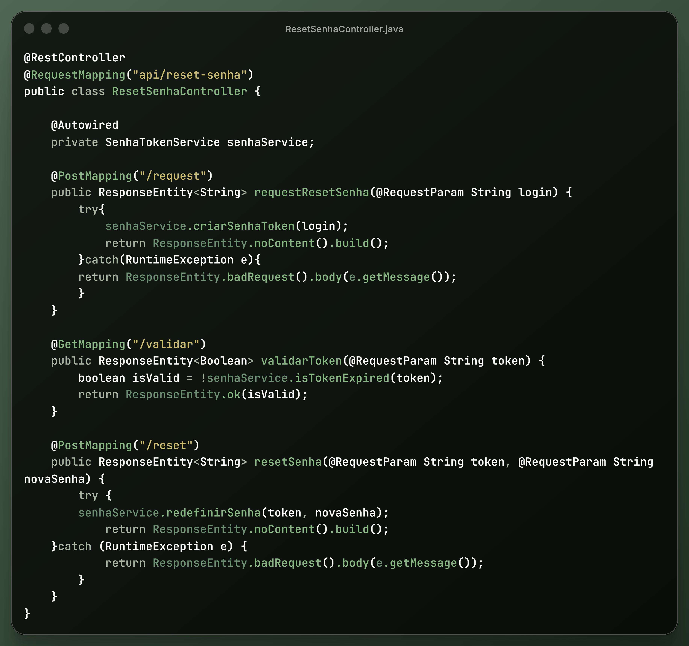
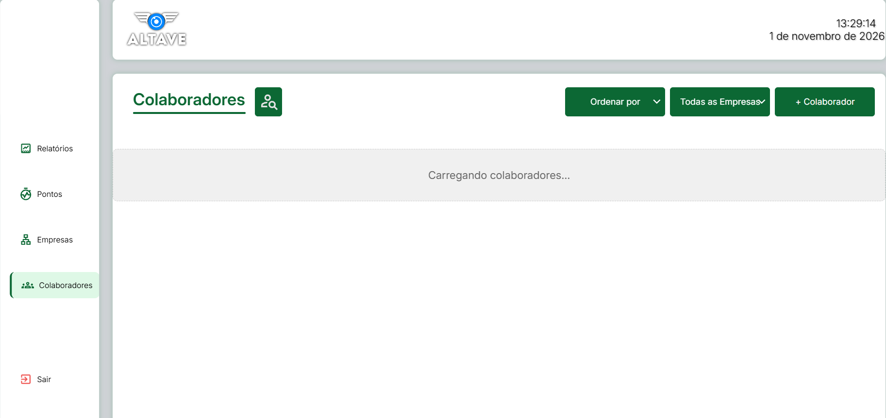
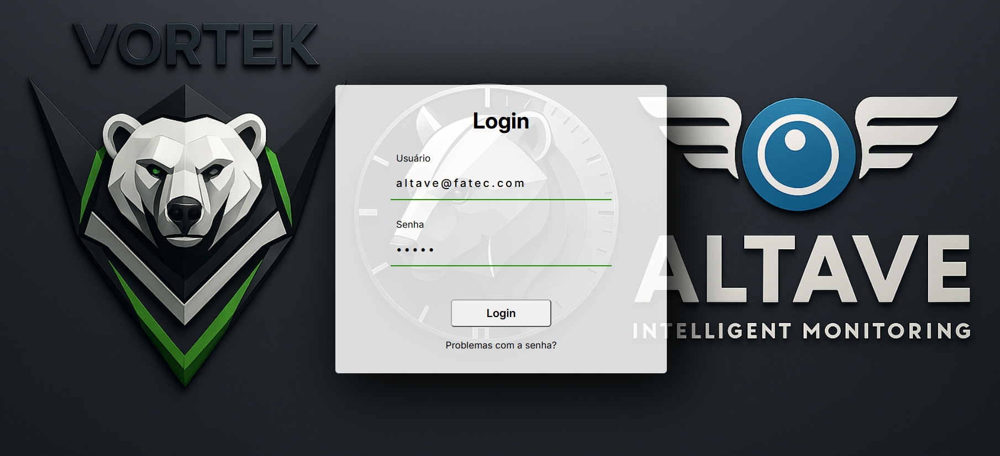

<i>Portfólio José Wesley</i>

<h1>3º Semestre 2025 - 1</h1>

Empresa Parceira - [Altave](https://altave.com.br/)

<i>Equipe [Vortek](https://github.com/Vortek-API/API3Sem)</i>

O <b>Sistema de Ponto</b> nomeado pela equipe de <b>TimeSync</b>é uma aplicação web desenvolvida para gerenciar o controle de ponto de funcionários em empresas terceirizadas, especialmente em áreas de manutenção. A plataforma oferece uma solução para o registro e acompanhamento das horas trabalhadas, otimizando a administração de equipes e contribuindo para maior precisão nos dados.

A aplicação utiliza um banco de dados relacional, estruturado para garantir a integridade das informações e dar suporte às funcionalidades do sistema. Além disso, conta com uma API responsável pela comunicação entre os diferentes módulos da aplicação, facilitando a integração e a manutenção do sistema.

Com foco em usabilidade e segurança, o TimeSync foi desenvolvido para atender às necessidades específicas do setor, proporcionando uma gestão de pessoal mais ágil e organizada.

 
 

 

<h2>Tecnologias Utilizadas</h2>

  

Java · TypeScript · HTML · CSS · Spring Boot  · Angular  · MySQL · VS Code · IntelliJ IDEA · Postman · Figma · Git · GitHub  

<h2>Metodologia de Desenvolvimento</h2>

Durante o desenvolvimento do projeto, as atividades foram realizadas
em equipe, utilizando Git e GitHub para versionamento e organização
das entregas.
As funcionalidades foram desenvolvidas de forma incremental, passando por análise dos requisitos, implementação, testes e integração com as demais partes da aplicação.

<h2>Contribuições Pessoais</h2>

<h3>Back-end</h3>

Validação de CNPJ

 

Desenvolvimento de um algoritmo para validação de CNPJ utilizando uma função booleana. A implementação verifica os dígitos verificadores do documento, permitindo identificar CNPJs inválidos antes do cadastro.

  
Funcionalidade de Login e Recuperação de Senha

   

Desenvolvimento do fluxo de autenticação e recuperação de senha utilizando Spring Boot.

A autenticação foi estruturada nas camadas Controller, Service, Entity e Security, com aplicação de hash nas senhas antes de seu armazenamento no banco de dados.

Para a recuperação de senha, foi implementado o envio de um token de validação para o e-mail do usuário, permitindo a redefinição segura da senha.

 

Criação e Edição de Usuários

 

Desenvolvimento de funcionalidades para gerenciamento de usuários utilizando Spring Boot.

Foram implementadas operações de cadastro, consulta, atualização dos vínculos com empresas e exclusão de usuários, organizadas nas camadas Controller, Service, Repository, Entity e DTO.

Padronização das Informações Exportadas

 

Ajuste na conversão dos registros de ponto para o formato detalhado de exportação. A implementação passou a organizar os registros por data mais recente, nome da empresa e nome do colaborador, proporcionando maior padronização e consistência nas informações exportadas.

<h3>Front-end</h3>

  
Estrutura de Navegação da Interface

   

Desenvolvimento dos componentes responsáveis pela navegação da aplicação, incluindo sidebar e header. A estrutura foi organizada para facilitar o acesso às principais funcionalidades e manter um padrão de navegação entre as telas.

  
  

  

  
Responsividade e Organização Visual

   
  

  Ajustes de layout e responsividade nas telas de empresas, colaboradores, relatórios e registros de ponto, além de adequações em modais, sidebar e header para melhorar a visualização em diferentes tamanhos de tela.
  

  
Funcionalidade de Login e Recuperação de Senha

   
  

Desenvolvimento da interface e da lógica de login e mensagens de notificação para orientar o usuário durante o processo de autenticação.

Implementação da interface de recuperação de senha, integrando o fluxo de redefinição de acesso à funcionalidade desenvolvida no back-end.

  

  
Criação e Edição de Usuários

   
  

  Desenvolvimento das interfaces para cadastro e edição de usuários, permitindo o gerenciamento das informações diretamente pela aplicação.

Também foi implementada a exibição da foto cadastrada na tabela de colaboradores.

  

  
Padronização Visual e Experiência do Usuário

   
  

Realização de ajustes visuais na interface, incluindo cores de fundo, dropdowns, dimensões gráficas e estrutura da página principal.

Foram adicionadas mensagens de sucesso, erro e indicação de campos obrigatórios nas funcionalidades de empresas, tornando o retorno das operações mais claro para o usuário.

  

  
Revisão Geral do Front-end

     
  

Revisão e refatoração de componentes do Front-end, com correção de inconsistências visuais e funcionais, ajustes na organização do código e padronização da interface entre diferentes telas.
  

<h3>Hard Skills</h3>

<table>
<thead>
<tr>
<th>Tecnologia</th>
<th>Descrição</th>
<th>Nível de autonomia</th>
<th>Experiência durante o projeto</th>
</tr>
</thead>

<tbody>
<tr>
<td>Java</td>
<td>Programação orientada a objetos, lógica de programação e desenvolvimento de funcionalidades.</td>
<td>Com auxílio</td>
<td>Desenvolvi funcionalidades e regras de negócio, mas precisei consultar documentações e exemplos para implementar soluções mais complexas.</td>
</tr>

<tr>
<td>Spring Boot</td>
<td>Desenvolvimento de APIs REST, organização em camadas e implementação de regras de negócio.</td>
<td>Com auxílio</td>
<td>Implementei funcionalidades utilizando as camadas Controller, Service e Repository, mas precisei de auxílio em configurações e implementações mais específicas do framework.</td>
</tr>

<tr>
<td>TypeScript</td>
<td>Implementação de funcionalidades, manipulação de dados e utilização de tipagem no desenvolvimento front-end.</td>
<td>Com auxílio</td>
<td>Utilizei tipagem e desenvolvi funcionalidades para a aplicação, mas precisei consultar documentações e exemplos para trabalhar com recursos mais específicos da linguagem.</td>
</tr>

<tr>
<td>Angular</td>
<td>Desenvolvimento de componentes, interfaces e funcionalidades para aplicações web.</td>
<td>Com auxílio</td>
<td>Desenvolvi e modifiquei componentes e interfaces, contando com auxílio para estruturar funcionalidades mais complexas.</td>
</tr>

<tr>
<td>HTML / CSS</td>
<td>Estruturação, estilização e responsividade de interfaces web.</td>
<td>Com auxílio</td>
<td>Estruturei e estilizei interfaces, realizando ajustes de layout e responsividade, mas precisei consultar referências para implementar determinados estilos e comportamentos visuais.</td>
</tr>

<tr>
<td>MySQL</td>
<td>Modelagem, consultas e manipulação de dados em bancos de dados relacionais.</td>
<td>Com auxílio</td>
<td>Utilizei o banco de dados para consultar e manipular informações da aplicação, recorrendo a referências para operações e consultas mais complexas.</td>
</tr>

<tr>
<td>Git / GitHub</td>
<td>Versionamento de código, gerenciamento de alterações e colaboração em equipe.</td>
<td>Com auxílio</td>
<td>Utilizei Git e GitHub para versionar o código, compartilhar implementações e integrar alterações, consultando referências para resolver situações mais específicas.</td>
</tr>

<tr>
<td>Postman</td>
<td>Testes e validação de requisições HTTP em APIs.</td>
<td>Autonomia</td>
<td>Configurei requisições, testei endpoints e analisei as respostas da API de forma independente durante a validação das funcionalidades.</td>
</tr>

<tr>
<td>Figma</td>
<td>Consulta e utilização de protótipos para orientar o desenvolvimento das interfaces.</td>
<td>Autonomia</td>
<td>Consultei protótipos e identifiquei elementos visuais e estruturais para orientar a implementação das interfaces.</td>
</tr>
</tbody>
</table>

<h3>Soft Skills</h3>

<ul align ="justify">
<li style="margin-bottom: 12px;">
<strong>Trabalho em equipe:</strong> Durante o desenvolvimento do TimeSync, trabalhei em conjunto com outros integrantes, compartilhando implementações e utilizando Git e GitHub para versionar o código e integrar funcionalidades. Essa experiência me permitiu compreender a importância da colaboração no desenvolvimento de software.
</li>

<li style="margin-bottom: 12px;">
<strong>Resolução de problemas:</strong> Ao longo do projeto, trabalhei na identificação e correção de inconsistências visuais e funcionais, investigando problemas no front-end e no back-end e testando soluções para garantir o funcionamento adequado das funcionalidades.
</li>

<li style="margin-bottom: 12px;">
<strong>Organização:</strong> Busquei organizar as funcionalidades de acordo com a estrutura da aplicação, trabalhando com componentes no front-end e separação de responsabilidades nas camadas do back-end, facilitando a manutenção e a compreensão do código.
</li>

<li style="margin-bottom: 12px;">
<strong>Adaptabilidade e aprendizado contínuo:</strong> Durante o projeto, tive contato com tecnologias como Java, Spring Boot, Angular e TypeScript. Precisei aprender novos conceitos e aplicá-los na prática para desenvolver as funcionalidades sob minha responsabilidade, ampliando meus conhecimentos técnicos.
</li>

<li style="margin-bottom: 12px;">
<strong>Atenção aos detalhes:</strong> Trabalhei em ajustes de responsividade, padronização visual, validações e mensagens de notificação, buscando melhorar a consistência das interfaces e tornar a utilização do sistema mais clara para o usuário.
</li>

</ul>